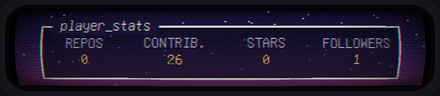
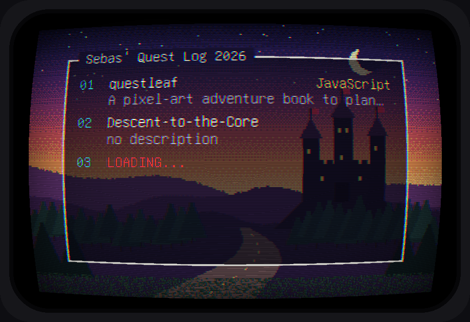
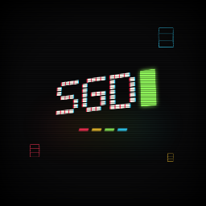

  

  

---
## stack.exe

  

---

## player_stats.sav

  

### `> quest_log.sav`

  

### `> snake.exe`

  <picture>
    <source media="(prefers-color-scheme: dark)" srcset="https://raw.githubusercontent.com/sebasGDevelop/sebasGDevelop/output/snake-vhs-dark.svg" />
    <source media="(prefers-color-scheme: light)" srcset="https://raw.githubusercontent.com/sebasGDevelop/sebasGDevelop/output/snake-vhs-light.svg" />
    
  </picture>

### `> contact`

  

  
  

